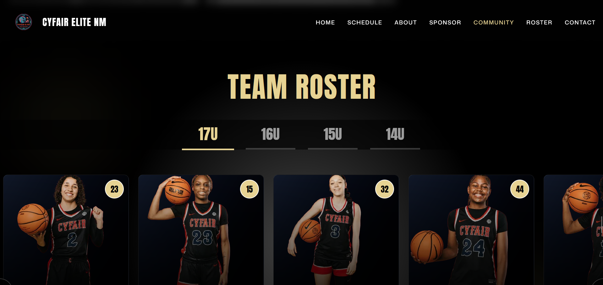
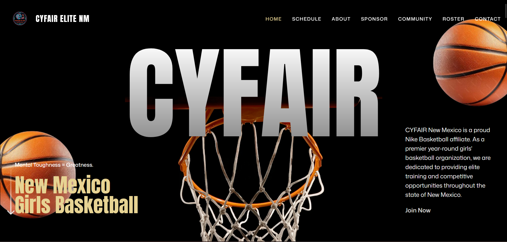
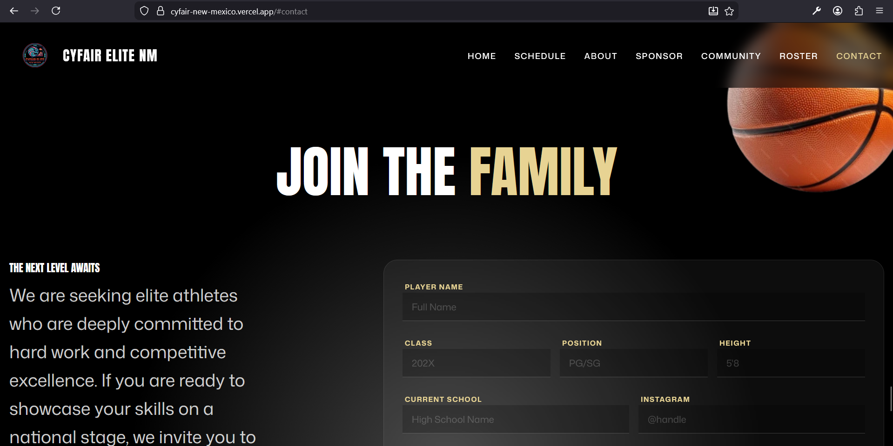

# Cyfair New Mexico: Digital Experience Overview

## Executive Summary
This document presents the newly developed digital platform for **Cyfair New Mexico**. Moving beyond a standard website, this application is a high-performance, interactive tool designed to elevate branding, streamline player showcasing, and drive organizational growth through effective fundraising and communication channels.

---

## 🚀 Key Features & Deliverables

### 1. Dynamic Roster Management

**Files:** `Roster.jsx`, `PlayerModal.jsx`
- **Interactive Player Cards**: A modern carousel interface replacing static lists.
- **Deep-Dive Profiles**: Modal views provide detailed statistics and bios without cluttering the main view.
- **Benefit**: engaging experience for scouts and families; easy to update.
> [🔗 **Live Demo: View Roster**](https://cyfair-nm.vercel.app#roster)

### 2. High-Impact Brand Visuals

**Files:** `Hero.jsx`, `Navbar.jsx`, `index.css`
- **Animation Engine**: Built with **GSAP (GreenSock Animation Platform)** for cinema-quality entrance animations and smooth transitions.
- **Responsive Design**: Flawless experience across mobile, tablet, and desktop devices.
- **Benefit**: Immediate "Wow" factor that establishes professional credibility.
> [🔗 **Live Demo: Main Page**](https://cyfair-nm.vercel.app)

### 3. Integrated Engagement Tools

**Files:** `Contact.jsx`, `Fundraising.jsx`, `Sponsorships.jsx`
- **Direct Communication**: Custom-built contact forms for general inquiries and recruitment.
- **Revenue Focus**: dedicated sections for fundraising and sponsorships to support program viability.
- **Benefit**: Converts passive visitors into active supporters and leads.
> [🔗 **Live Demo: Contact Support**](https://cyfair-nm.vercel.app#contact)

---

## 🛠 Technical Architecture "Under the Hood"

We have utilized a cutting-edge **"Elite Tier" Tech Stack** to ensure longevity and performance:

| Component | Technology | Why it matters |
| :--- | :--- | :--- |
| **Core Framework** | **React 19** | The latest standard for interactive web UI. Future-proof and robust. |
| **Build Engine** | **Vite** | Lightning-fast load times. Stakeholders won't wait for pages to load. |
| **Styling** | **Tailwind CSS v4** | A bespoke design system (not a generic template) allowing for pixel-perfect branding. |
| **Animations** | **GSAP** | Industry-standard for high-end web motion capability. |

---

## 🔮 Future Roadmap (Phase 2 Opportunities)

- **Live Game Integration**: Real-time score ticker.
- **Alumni Portal**: Database of past players and their college commitments.
- **Merchandise Store**: Integrated e-commerce for team gear.

---

> [!NOTE]
> This platform is built to scale. As the organization grows, the codebase is ready to expand with it.
