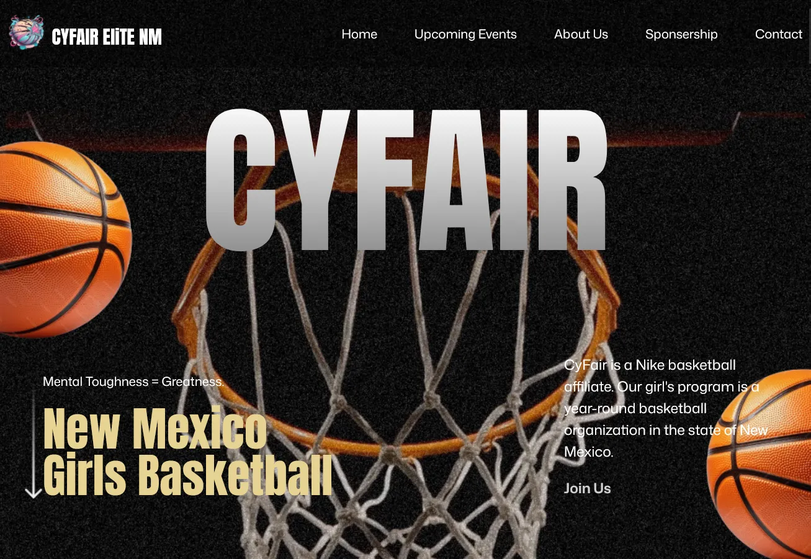
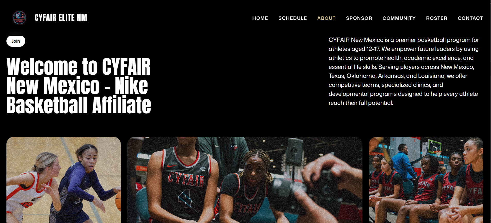
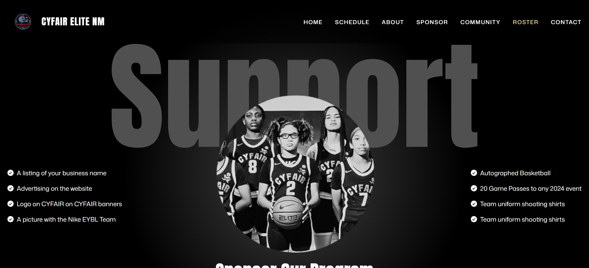

<!--
    ____  ___    __  ___
   / __ \/   |  /  |/  /
  / /_/ / /| | / /|_/ / 
 / _, _/ ___ |/ /  / /  
/_/ |_/_/  |_/_/  /_/ 
CyFair Elite New Mexico
Version 1.0
-->

<div align="center">
  
# 🚀 CyFair Elite New Mexico 🏀

### Mental Toughness = Greatness.

[](LICENSE.txt)
[](https://github.com/rayanthoney/cyfair_new_mexico/releases)
[](https://github.com/rayanthoney/cyfair_new_mexico/actions)
[](http://makeapullrequest.com)

[**Live Demo**](https://github.com/rayanthoney/cyfair_new_mexico) · [**Documentation**](https://github.com/rayanthoney/cyfair_new_mexico/wiki) · [**Report Bug**](https://github.com/rayanthoney/cyfair_new_mexico/issues) · [**Request Feature**](https://github.com/rayanthoney/cyfair_new_mexico/issues)



</div>

---

## 📋 Table of Contents

- [About The Project](#about-the-project)
- [✨ Features](#features)
- [🎯 Demo](#demo)
- [⚙️ Tech Stack](#tech-stack)
- [🚀 Getting Started](#getting-started)
  - [Prerequisites](#prerequisites)
  - [Installation](#installation)
- [💻 Usage](#usage)
- [️ Roadmap](#roadmap)
- [🤝 Contributing](#contributing)
- [📜 License](#license)
- [👤 Contact](#contact)
- [🙏 Acknowledgments](#acknowledgments)

---

## 📖 About The Project

<div align="center">
  
  &nbsp;&nbsp;&nbsp;&nbsp;
  
</div>

**CyFair Elite New Mexico** is a premier Nike Basketball affiliate organization dedicated to empowering female athletes through elite training and national competition. We provide a platform for girls aged 12–17 to develop their skills, mental toughness, and academic excellence.

### Why CYFAIR NM?

- 🎯 **Elite Training** - Professional-grade coaching and developmental clinics year-round.
- 💡 **Mental Toughness** - Focused on building resilience and leadership both on and off the court.
- ⚡ **National Exposure** - Competitive tournament play across several states (NM, TX, OK, AR, LA).

<p align="right">(<a href="#top">back to top</a>)</p>

---

## ✨ Features

<div align="center">

| Feature | Description |
|---------|-------------|
| � **Nike Affiliate** | Proudly affiliated with Nike Basketball for elite performance. |
| � **Live Schedule** | Interactive tournament and training calendar with real-time results. |
| � **Roster Management** | Comprehensive player profiles organized by 14U to 17U divisions. |
| 🤝 **Sponsorships** | Streamlined corporate partnership and support opportunities. |
| 📸 **Community Gallery** | Visual archive of community moments and fundraising events. |
| � **Recruitment Form** | Integrated digital player profile submission for aspiring athletes. |

</div>

<p align="right">(<a href="#top">back to top</a>)</p>

---

## 🎯 Demo

### 🌐 Live Site
Visit our official platform: **[cyfairelitenm.com](https://cyfair-new-mexico.vercel.app/)**

### � Visual Experience
The site features smooth **Lenis** scrolling and high-performance **GSAP** animations to reflect the dynamic nature of elite athletics.

<p align="right">(<a href="#top">back to top</a>)</p>

---

## ⚙️ Tech Stack

### Frontend
[](https://react.dev/)
[](https://tailwindcss.com/)
[](https://gsap.com/)
[](https://vite.dev/)

### Utilities
[](https://lenis.darkroom.engineering/)
[](https://eslint.org/)

<!-- <div align="center">
  <a href="https://skillicons.dev">
    
  </a>
</div> -->

<p align="right">(<a href="#top">back to top</a>)</p>

---

<details>
<summary><h2>🚀 Getting Started (Click to Expand)</h2></summary>

Follow these steps to get a local copy up and running.

### Prerequisites

Before you begin, ensure you have the following installed:

- **Node.js** (v18 or higher)
  ```sh
  node --version
  ```

- **npm**
  ```sh
  npm --version
  ```

### Installation

1. **Clone the repository**
   ```sh
   git clone https://github.com/rayanthoney/cyfair_new_mexico
   ```

2. **Navigate to the project directory**
   ```sh
   cd cyfair_new_mexico
   ```

3. **Install dependencies**
   ```sh
   npm install
   ```

4. **Start the development server**
   ```sh
   npm run dev
   ```

5. **Open your browser** and navigate to:
   ```
   http://localhost:5173
   ```

</details>

<p align="right">(<a href="#top">back to top</a>)</p>

---

<details>
<summary><h2>💻 Usage (Click to Expand)</h2></summary>

### Components
The application is built modularly with reusable components:
- `Navbar.jsx`: Fixed navigation with active state tracking.
- `Hero.jsx`: High-impact landing section with video background.
- `Upcoming.jsx`: Tabbed schedule for tournaments and training.
- `Roster.jsx`: Divisional player showcase.
- `Contact.jsx`: Complex recruitment form with validation.

### Available Scripts

| Command | Description |
|---------|-------------|
| `npm run dev` | Starts the Vite development server |
| `npm run build` | Builds the app for production (Vite) |
| `npm run preview` | Preview production build locally |
| `npm run lint` | Lints the codebase using ESLint |

</details>

<p align="right">(<a href="#top">back to top</a>)</p>

---

## �️ Roadmap

- [x] **Phase 1: Initial Launch**
  - [x] Core UI Implementation
  - [x] Roster & Schedule Integration
  - [x] Responsive Design

- [ ] **Phase 2: Advanced Features**
  - [ ] Player Stats Integration
  - [ ] Dynamic Blog/News Section
  - [ ] Enhanced Gallery Lightbox

- [ ] **Phase 3: Community Hub**
  - [ ] Online Store / Merch
  - [ ] Parent/Player Portal

<p align="right">(<a href="#top">back to top</a>)</p>

---

<details>
<summary><h2>🤝 Contributing (Click to Expand)</h2></summary>

Contributions are what make the open-source community such an amazing place to learn, inspire, and create. Any contributions you make are **greatly appreciated**! 🎉

### How to Contribute

1. **Fork the Project**
2. **Create your Feature Branch** (`git checkout -b feature/AmazingFeature`)
3. **Commit your Changes** (`git commit -m 'Add some AmazingFeature'`)
4. **Push to the Branch** (`git push origin feature/AmazingFeature`)
5. **Open a Pull Request**

</details>

<p align="right">(<a href="#top">back to top</a>)</p>

---

## 📜 License

Distributed under the MIT License. See [LICENSE.txt](LICENSE.txt) for more information.

<p align="right">(<a href="#top">back to top</a>)</p>

---

## 👤 Contact

**RayAnthoney**

[](https://github.com/rayanthoney)
[](https://instagram.com/rayanthoney)
[](mailto:contact@rayanthoney.com)

**Project Link:** [https://github.com/rayanthoney/cyfair_new_mexico](https://github.com/rayanthoney/cyfair_new_mexico)

<p align="right">(<a href="#top">back to top</a>)</p>

---

<details>
<summary><h2>🙏 Acknowledgments (Click to Expand)</h2></summary>

- [JavaScript Mastery](https://jsmastery.com/) - For layout and animation structure inspiration.
- [Cyfair Elite Basketball](https://www.cyfairelitebasketball.com/) - Parent organization.
- [GreenSock](https://gsap.com/) - For the incredible animation tools.
- [Lenis](https://lenis.darkroom.engineering/) - For smooth scrolling performance.

</details>

<p align="right">(<a href="#top">back to top</a>)</p>

---

<div align="center">

### ⭐ Star this repo if you find it helpful!

Made with ❤️ by RayAnthoney's Antigravity


</div>
